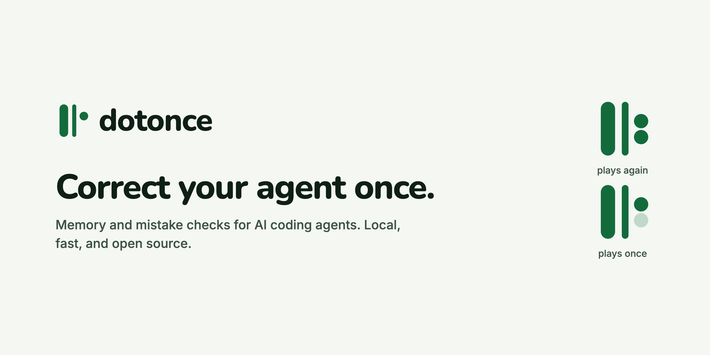

<picture>
  <source media="(prefers-color-scheme: dark)" srcset=".github/assets/cover-dark.png">
  
</picture>

# dotonce

Long-term memory and mistake checks for AI coding agents like Claude Code, Codex, and Cursor. Correct your agent once, and it remembers.

## Why dotonce

You tell your agent not to do something. It says it understands. Two sessions later it does it again.

That happens because every session starts from zero. Notes in `CLAUDE.md` or a memory file help, but the agent reads them as suggestions, and a long list of rules gets skipped. The research on this is clear: the more rules an agent carries, and the further they sit from the moment they matter, the more often it ignores them.

dotonce works the other way round. Right before your agent acts, it finds the few facts and rules that matter for what you just asked and hands them over with their sources. Then it checks what the agent does against the rules you set, and stops a mistake you already corrected.

It runs on your machine. There's no server to run, no API key to add, and no AI model to download.

dotonce is free and open source. It's in early development, and there's no release yet.

## What works today

- **Your facts, as plain files:** every fact is a markdown file with its source and date. Point dotonce at a folder you already keep notes in, and it reads those files as they are.
- **Context before each prompt:** a Claude Code hook finds the few facts that match what you just asked and adds them, with their dates and files, before Claude answers. Pinned facts are added at the start of every session and again after the context is compacted.
- **Private facts stay private:** a fact marked private only shows when Claude Code runs inside a folder you list as private. Facts you save from inside one of those folders are private by default.
- **Rules and reply checks:** rule sets you write turn on when Claude uses a skill, works in a folder, or gets a prompt with certain words. They remind Claude right then, check each reply's drafts and each tool call, and send a broken draft back once with the exact line and the reason. Every catch is logged, so you can see which rules earn their place.
- **Search engine:** keyword search, typo-tolerant matching, names, and dates, merged and fitted into a token budget. With 100,000 stored turns a search takes about 26 ms, and 95% finish within 31 ms on an Apple M3 Pro. The prompt hook runs in about 20 ms on a store of 550 facts.
- **Benchmark adapter:** runs dotonce on LongMemEval and LoCoMo, two of the most used tests for AI agent memory, through the open [agent-memory-benchmark](https://github.com/vectorize-io/agent-memory-benchmark) runner. That puts it side by side with other memory tools, with the same answering model and the same judge.

## What's coming

- **Rules from corrections:** when you correct Claude, dotonce drafts the rule set for you, and it only runs after you approve it.
- **More agents:** an MCP server for Codex, Cursor, and any other MCP client.

## How it's built

- **Local only:** dotonce makes no network calls. No telemetry, no auto-update.
- **One small binary:** written in Rust, with SQLite built in. Nothing else to install or keep running.
- **No extra AI cost:** the agent you already use does the reasoning, so dotonce adds no model calls of its own.
- **Facts keep their source:** when something changes, the old fact is marked as replaced, never silently rewritten.

## Build from source

You need Rust 1.85 or later.

```
git clone https://github.com/dotbrainhq/dotonce.git
cd dotonce
cargo build --release
cargo test
```

The speed check is skipped by default. Run it in release mode:

```
cargo test --release --test speed -- --ignored --nocapture
```

## Use it with Claude Code

Install the binary, then create the config and a notes folder in `~/.dotonce`:

```
cargo install --path .
dotonce init
```

Save a fact and find it again:

```
dotonce save "The staging site is staging.example.com" --source "team wiki"
dotonce search "staging site"
```

Print the hooks block, then add its entries to the `hooks` section of `~/.claude/settings.json`:

```
dotonce hook-config
```

From then on, each prompt gets the facts that match it. If a hook goes wrong, it adds nothing, blocks nothing, and writes the error to `~/.dotonce/errors.log`.

Run `dotonce doctor` to check that every hook is there. It only reads your settings files and never changes them.

### Use a folder you already have

Any folder of markdown files with frontmatter works as a store. Add a `[[stores]]` block at the end of `~/.dotonce/config.toml`:

```
[[stores]]
name = "kb"
path = "~/notes"
```

dotonce reads the files in place and never changes them. Facts with `privacy: private` in their frontmatter only show when Claude Code runs inside a folder listed in `private_paths`. Edit the `private_paths = []` line near the top of the file:

```
private_paths = ["~/projects/personal"]
```

Keep `private_paths` above the first `[[stores]]` block. Below it, TOML reads the line as part of that store, and dotonce refuses the config with an error that names the key.

Run `dotonce index` to check the store. It prints how many facts were added, updated, and removed.

## Rules and reply checks

A rule set is a small TOML file in `~/.dotonce/rules/`. It turns on when Claude does a certain kind of work, and then it can do three things:

- Add a reminder to Claude's context right when the set turns on.
- Check the drafts in Claude's reply after it answers.
- Check a tool call before it runs.

dotonce ships no rules of its own. Every set is a file you write and approve. Sets are read only from `~/.dotonce/rules/`, never from a project folder, so a cloned repo can't bring rules that run without your yes.

### What you see

A broken draft is never hidden. Every line shows as Claude writes it, and dotonce checks a draft once its fence closes. When a draft that breaks a rule in a `fix` set closes, dotonce adds one line right after it:

```
dotonce: the draft above breaks your inline-links rule. A corrected one follows.
```

Claude then writes the corrected draft, with one line saying what it fixed. Copy the second one.

A tool call that breaks a `fix` set's tool check is denied. Claude sees which rule and why, and tries another way.

### Levels

| Level | What it does |
|---|---|
| `remind` | Adds the set's reminder when it turns on. No checks. |
| `warn` | Reminds and runs the checks, but only logs what fails. Nothing is sent back or denied. |
| `fix` | Reminds, runs the checks, sends a failing draft back once, and denies a tool call that fails a tool check. |

A new set starts at `warn`, so it only logs. Run `dotonce rules test` on a few real replies, watch the catch log for a while, and move the set up once both look right:

```
dotonce rules level support-replies fix
```

### Turning sets on

| In `[when]` | Turns the set on | For how long |
|---|---|---|
| `skills` | When Claude uses one of these skills, or you run one as a slash command. `support-reply` also matches `my-plugin:support-reply`. | The rest of the session. |
| `folders` | When Claude Code works inside one of these folders. | While it works there. |
| `prompt` | When your prompt has one of these words, matched as whole words in any case. Pasted text and fenced blocks don't count. | That turn. Only the reminder, unless the set has `check_on_prompt = true`. |

A set with `private = true` is only on inside the folders in `private_paths`, like private facts.

### Write a rule set

```
dotonce rules new support-replies
```

This writes a commented starter file with one example of each check kind. It asks whether the set checks fenced drafts or whole replies, or you can pass `--drafts` or `--whole-reply`.

A coder's set that logs force pushes in your code folder, and denies them once it's at `fix`:

```
id = "git-safety"
level = "warn"

[when]
folders = ["~/code"]

[[check]]
id = "no-force-push"
on = "tool"
tool = "Bash"
forbid_regex = 'git\s+push\b.*(--force|-f\b)'
why = "Never force push. Ask first."
```

A writer's set for support replies. It turns on with the `support-reply` skill or a prompt that asks for a draft, and it checks only the fenced drafts, not the chat around them:

```
id = "support-replies"
level = "warn"

[when]
skills = ["support-reply"]
prompt = ["draft", "reply"]

[draft]
fence = ["markdown", "draft"]

[remind]
text = """
Open with a line from the customer's message, never a stock apology.
Links go inline as anchor text, never bare.
"""

[[check]]
id = "no-stock-opener"
forbid = ["sorry for the wait", "sorry for the delay"]
why = "Open with a line from the customer's message."

[[check]]
id = "inline-links"
kind = "bare-url"
why = "Links go inline as anchor text."

[[check]]
id = "name-once"
repeat_of = '^Hi (\w+),'
max = 0
why = "Use the name once, in the greeting."
```

A draft is a fenced block whose info string is in `fence`. Use `""` for fences with no info string. A longer fence can hold a shorter one, so a draft can carry a code snippet. Without a `[draft]` table, the checks read the whole reply.

| Check | Fails when |
|---|---|
| `forbid = [phrases]` | Any phrase appears, at word boundaries, in any case. |
| `forbid_regex = '...'` | The pattern matches. `^` and `$` match at each line. |
| `require = [phrases]` | None of the phrases appears. |
| `kind = "bare-url"` | A URL sits outside `[text](url)` and outside code. |
| `repeat_of = '...'` and `max = N` | The text the pattern's one group captures appears more than N times after its first match. |
| `max_paragraphs = N` | The draft has more than N paragraphs. |
| `max_words = N` | The draft has more than N words. |

A tool check adds `on = "tool"` and a `tool`: `"Bash"`, `"Write"`, `"Edit"`, `"MultiEdit"` or `"NotebookEdit"`. It reads the command, or the file path and the new text. `path = ["*.rs"]` limits it to matching files. Tool checks turn on the same way reply checks do, so a coder's set usually uses `folders`. MCP tools that write files aren't covered.

Parsing is strict. An unknown field, a check with no kind or two kinds, or a missing `id` or `why` is an error, and the whole file is skipped. Try a set on a file before you approve it:

```
dotonce rules check
dotonce rules test support-replies reply.md
dotonce rules test git-safety command.txt --tool Bash
```

With `git push --force origin main` in `command.txt`, the last one prints:

```
no-force-push: "git push --force origin main"
  Never force push. Ask first.
```

### Approve it

```
dotonce rules approve support-replies
dotonce rules level support-replies fix
dotonce rules off support-replies
```

A set does nothing until you approve it. Approval records the file's hash in `~/.dotonce/approvals.json`, outside the rule file. The first approval takes the level from the file. After that the level lives with the approval, so `rules level` changes it and editing the file's `level` line doesn't. Any edit to the file turns the set off, and `dotonce rules list` shows it as "changed since approval" until you approve it again. To turn a set back on after `rules off`, give it a level with `rules level`.

Approving, changing a level, `rules off` and `rules pause` only run from your own terminal. Each needs a real terminal and the set's id typed in, and each refuses to run when `CLAUDECODE` or `CLAUDE_CODE_ENTRYPOINT` is set. Claude Code sets both for every command its Bash tool runs.

A guard runs before every Bash, Write, Edit, MultiEdit and NotebookEdit call, with or without rule sets. It stops Claude from editing rule files or approval state, and from running those four commands. Claude can still read a rule file with its file-reading tool, but a Bash read of the rules folder, like `cat ~/.dotonce/rules/acme.toml`, is blocked.

The guard has limits. An agent with a shell can't be fully stopped from changing files it can reach. The guard reads only the text of the command Claude sends, so a script file, a command built while it runs, an alias, or a `cd` into the dotonce home followed by relative paths can get past it. Every change still shows in `dotonce rules list`, and the next session start shows a notice for a level you didn't set, a set turned off, or a file changed since approval.

### See what it catches

```
dotonce rules list
dotonce rules why
dotonce rules log
dotonce stats
dotonce rules pause support-replies
```

`rules list` shows each set's level, approval state and last catch. `rules why` shows which sets are on in this folder for the newest session, and what turned each one on. `rules log` prints recent catches.

`stats` counts catches per check over 7 and 30 days, with how many were fixed on the send-back, how many were still broken, and how many tool calls were denied. Its last column is the repeat-mistake rate, catches per week. A check that keeps catching shows the mistake keeps happening. One that never catches may not be earning its place.

The log keeps ids and outcomes, never reply text. Lines for private sets go to their own file and only show inside `private_paths`. `rules pause` turns a set off for the current session only, from your terminal.

### Set up the hooks

`dotonce hook-config` prints seven hook entries: UserPromptSubmit, SessionStart, Stop, PostToolUse for the Skill tool, UserPromptExpansion, PreToolUse for tool checks and the guard, and MessageDisplay for the line under a broken draft. Coming from v0.1, you have the first two.

`dotonce doctor` reads `~/.claude/settings.json` and the project's `.claude/settings.json` and `.claude/settings.local.json`, and lists the hooks that are missing. It also warns when one of those files sets `DOTONCE_HOME`, because the hooks would then read approvals from that folder instead of your dotonce home. It never changes the files.

A rule file with an error is skipped whole, never half-loaded. The next session start tells you which file and why, and `dotonce rules check` prints the details.

## Run the benchmark

The adapter in `bench/amb/` plugs dotonce into a local copy of the agent-memory-benchmark runner. The runner needs Python 3.11, [uv](https://docs.astral.sh/uv/), and an API key for the answering model.

```
python3 bench/amb/install.py /path/to/agent-memory-benchmark
cd /path/to/agent-memory-benchmark
DOTONCE_BIN=/path/to/dotonce/target/release/dotonce uv run python /path/to/dotonce/bench/amb/smoke.py
```

`bench/amb/compare.py` compares result files on the same questions, and stops if the answering model or judge differ. Results go here once the full runs are done.

## Questions

### How is this different from CLAUDE.md or a memory file?

Those files are loaded in full at the start of a session, and the agent decides what to follow. dotonce picks only what fits the task in front of it, shows where each fact came from, and checks the agent's actions against your rules instead of hoping it remembers.

### Does my code or chat history leave my machine?

No. dotonce makes no network calls. Everything stays in a local SQLite file you can open, copy, or delete.

### Do I need an API key?

Not for dotonce itself. The benchmark runner needs one for its answering model, because that's how the test is scored.

### How does it compare with Hindsight, Mem0, or claude-mem?

Many popular memory tools run a background server, or call an AI model every time they save something. dotonce does neither, and it's built to block a repeated mistake, not only remind the agent about it. Benchmark numbers will be published here, run with the same models other tools used.

## Project layout

| Path | What it is |
|---|---|
| `src/` | The search engine and the `dotonce` command. |
| `tests/` | End-to-end and speed tests. |
| `bench/amb/` | The benchmark adapter, installer, smoke test, and comparison script. |
| `brand/` | The mark, icons, and the script that rebuilds them. |

## Contributing

See [CONTRIBUTING.md](CONTRIBUTING.md). To report a security issue, see [SECURITY.md](SECURITY.md).

## License

The code is released under the [MIT License](LICENSE). The dotonce name and icon are not covered by the license, so please use your own name and icon if you ship a copy.

Made by Dotbrain.
